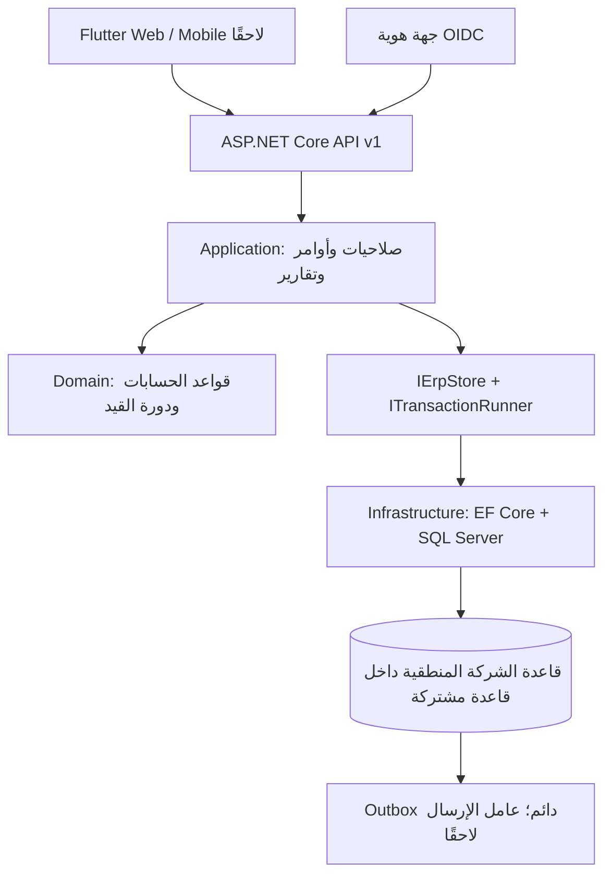

# قرارات بنية الباك إند

المشروع يبدأ بوحدة مالية قابلة للاختبار داخل **Modular Monolith**: تطبيق واحد وقاعدة واحدة ومعاملة واحدة للأثر المالي. تقسيم الخدمات الشبكي الآن يضاعف تعقيد ذرية الترحيل المطلوبة في BR05. الوحدات التالية تدخل حدود التطبيقات نفسها مع خدمات مجال واضحة، دون نسخ منطق الترحيل لكل قسم.

## التقنية

الهدف .NET 10 LTS مع ASP.NET Core وEF Core وSQL Server. [سياسة دعم Microsoft](https://dotnet.microsoft.com/en-us/platform/support/policy) توضح دورة دعم .NET؛ البناء والتشغيل والاختبار جميعها على SDK 10 بعد إتمام التحقق المحلي الفعلي. تفاصيل القيود والاختبارات في [دليل التشغيل](../../backend/README.md).

الواجهة المستقبلية المقترحة **Flutter**، بواجهات ويب وموبايل تتصل بعقود API نفسها. [توثيق Flutter للمنصات](https://docs.flutter.dev/platform-integration) و[الويب](https://docs.flutter.dev/platform-integration/web) يوضحان الدعم. تطبيق الموبايل لا يحتاج تغليف صفحات الويب داخل WebView. هذا قرار تقني للمرحلة المقبلة؛ لم تُنشأ واجهة ولم يُقَس حجمها أو أداؤها بعد. جداول المحاسبة العربية والطباعة ولوحة المفاتيح تحتاج نماذج اختبار قبل اعتماد تجربة الواجهة النهائية.

## الطبقات

`Domain` لا يعتمد على EF أو HTTP. `Application` يطبق صلاحيات الشركة والفروع ويجمع التغيير المالي والتدقيق والأحداث. `Infrastructure` يترجم ذلك إلى SQL. `Api` يحدد المصادقة وعقد JSON وحالات الاستجابة. مشاريع الاختبار تنفذ سيناريوهات أعمال، لا مجرد اختبارات للـgetters.

## معاملة الكتابة

كل أمر يمر عبر `SqlTransactionRunner` بعزل `Serializable` وقفل `sp_getapplock` مرتبط بالمعاملة وبمعرف الشركة. بذلك يتسلسل الترحيل وإغلاق الفترة وتغيير الصلاحيات وترقيم المستندات داخل الشركة نفسها. هذا يفضل صحة العمليات في البداية؛ حد التوازي للشركة قرار أداء يجب قياسه قبل تخفيف القفل.

بعد أخذ القفل تُفحص العضوية الحالية، ثم يبحث مفتاح منع التكرار. إعادة الطلب بنفس الشركة والمفتاح والمستخدم والعملية والمحتوى تعيد إيصال العملية الأصلي. اختلاف أي منها ينتج تعارضًا. لا تُخزن نتيجة عند فشل العملية. إيصال إعادة الطلب يصف العملية الأصلية؛ قد يكون المستند انتقل لاحقًا إلى حالة أحدث، ولذلك تعرض الواجهة التفاصيل من GET بعد العمليات.

تغييرات القيد والتدقيق وتسلسل الرقم وOutbox وإيصال الطلب تحفظ داخل المعاملة نفسها. يوجد فهرس فريد للشركة ورقم القيد وآخر للشركة ومفتاح الطلب وآخر لحدث الترحيل ومورده. `Version` رمز تعديل Guid يفحص في التطبيق وتستخدمه EF كـconcurrency token. وقت التدقيق من الخادم UTC، والتواريخ المحاسبية `DateOnly`.

لا يوجد عامل لتسليم أحداث Outbox بعد. حفظ الحدث يهيئ الخطوة اللاحقة، ولا يعني إرسال إشعارات أو فاتورة إلكترونية. الدفاتر المساعدة والمستندات المصدر وروابط سطورها في ERD الأصلي غير منفّذة في هذه المرحلة.

## حدود العزل والهوية

جهة OIDC تتحقق من الهوية. API تتحقق من التوقيع والعمر والـissuer والـaudience؛ لا تؤخذ صلاحيات الشركة من رأس HTTP يختاره العميل. `sub` يطابق عضوية مفعلة في الشركة؛ claim الدور `erp.platform-admin` يسمح بإنشاء الشركة فقط. عضوية المنشئ الأولية لا تمنحه اعتمادًا أو ترحيلًا ماليًا ضمنيًا.

المفاتيح الأساسية للكيانات التابعة مركبة من `CompanyId, Id`، وعلاقات الحساب/الفترة/السطر/المركز/الفرع تتضمن الشركة. أغلب عمليات القراءة المالية تتحقق من العضوية ثم نطاق الفرع. لا يوجد SQL Row-Level Security؛ الحماية من طلبات التطبيق في طبقة التطبيق والمفاتيح المركبة، وحماية اتصال SQL تحتاج دور تشغيل محدودًا. نطاقات مستقلة لمجموعات الحسابات والأسعار والصناديق والمخازن لم تنفذ بعد.

التدقيق وأسعار الصرف التاريخية وإيصالات الأوامر غير قابلة للتعديل في طبقة الحفظ، ويمنع دور قاعدة البيانات المقترح تعديلها وحذفها. لا يمنع ذلك مسؤول SQL ذي الامتيازات العليا من تعديل البيانات خارج النظام؛ إدارة وصول المسؤول والنسخ الاحتياطي خارج هذه الدفعة.

## المبالغ والتقارير

المبالغ .NET `decimal` وليست `double`. حقول المبلغ في SQL `decimal(20,6)`، وسعر الصرف `decimal(20,10)`، مع حد مبلغ أقل من 100 تريليون ودقة عملة بين 0 و6. المدخلات التي تفقد دقة عند التحليل تُرفض. التقريب إلى دقة العملة الوظيفية `AwayFromZero` لكل سطر؛ أي فرق اتزان يُعالج صراحة ولا يختفي تلقائيًا.

JSON يُخرج المبالغ والأسعار كسلاسل عشرية، ويحافظ عميل Flutter على النص أو نوع Decimal مناسب. لا يحولها إلى JavaScript number أو Dart double للحساب المالي. مخطط OpenAPI يصفها كسلاسل. تفاصيل [تخصيص OpenAPI الرسمية](https://learn.microsoft.com/en-us/aspnet/core/fundamentals/openapi/customize-openapi) هي مرجع محول المخطط.

الأستاذ وميزان المراجعة يقرآن القيود `Posted` و`Reversed` الأصلية، ويضيفان القيد العكسي المستقل عند تاريخ أثره؛ تغيير حالة الأصل إلى Reversed لا يسقط تاريخه. المسودات لا تدخل الأرصدة. التقارير وظيفية الآن؛ يتيح الميزان تجميع أقصى عمق للدليل دون ازدواج الأب والأبناء، ومرشح المركز وإخفاء الصفوف الصفرية. يتيح الأستاذ مرشح المركز والمرجع الخارجي المطابق تمامًا. لا قوائم قانونية أو حساب ضريبة أو تجميع ميزانية.

قوائم الحسابات والقيود والعضويات والتدقيق تُرحّل Pagination إلى SQL. التقارير الحالية تجلب القيود ذات الصلة وتحسب في التطبيق، وبعض قوائم التهيئة غير مقسمة إلى صفحات. يلزم نقل التجميع إلى استعلامات SQL مناسبة واختبار أحجام فعلية قبل تشغيل أرشيف كبير. لا يوجد ضمان snapshot موحد بين عدة استعلامات تقرير متزامنة مع تغيير بيانات الإعداد؛ يلزم سياسة عزل تقارير قبل الاعتماد الإنتاجي.

## ما يجب إكماله قبل الإنتاج

نجح بناء .NET 10 وحزمة SQL الفعلية ومضيف HTTPS مع جهة OIDC مؤقتة وفحص OpenAPI. تبقى تهيئة جهة هوية النشر، وقياس أداء الأرشيف والتزامن، والتحقق من شهادات الخدمة والنسخ والاستعادة والمراقبة وحدود الطلبات، ثم استكمال الحقول والشاشات في مصفوفة المطابقة. الاختبارات المحلية ليست اعتمادًا إنتاجيًا لنظام ERP كامل.

تثبت ملفات `packages.lock.json` التبعيات، ويظل فحص NuGet للتبعيات المباشرة والمتعدية مفعّلًا. أضيف مرجع PKCS 10.0.13 صريح لتجاوز تبعية SqlClient الأقدم التي أبلغ عنها الفحص؛ الإصدار المصحح موضح في [تنبيه Microsoft الأمني](https://github.com/advisories/GHSA-846f-f764-76mx).
