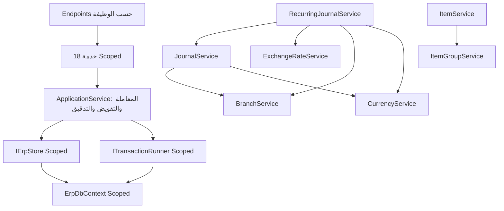

# تنظيم ملفات الباك إند

أعيد تنظيم الملفات بعد دفعة INV01 استجابة لطلب فصل المسارات والكيانات والعقود. لا تضيف هذه الدفعة وظيفة أعمال أو ترقية قاعدة بيانات؛ يبقى SchemaVersion 11. تبقى أسماء الأنواع وnamespaces العامة كما كانت للحفاظ على توافق المستهلكين وعقد JSON وEF. المجلدات تعبر عن المسؤولية الحالية دون فرض إعادة تسمية عامة للعقود.

## خريطة المشروع

```text
backend/src/
├── Ameen.Erp.Api/
│   ├── Endpoints.cs                  # تجميع تسجيل الوحدات فقط
│   ├── Endpoints/
│   │   ├── EndpointRoutes.cs          # بادئة الشركة المشتركة
│   │   ├── CompaniesEndpoints.cs
│   │   ├── AccountsEndpoints.cs
│   │   ├── JournalsEndpoints.cs
│   │   ├── WarehousesEndpoints.cs
│   │   └── ...                       # 17 مجموعة حسب الوظيفة
│   ├── ApiHost.cs                     # إعداد المضيف والمصادقة وDI
│   ├── ApiSupport.cs                  # هوية الطلب والمفتاح والأخطاء
│   └── OpenApiConfiguration.cs
├── Ameen.Erp.Application/
│   ├── Abstractions/                  # IErpStore / ITransactionRunner / IClock
│   ├── Common/                        # ApplicationService للتنفيذ والتفويض والصفحات والساعة
│   ├── Features/
│   │   ├── Company/CompanyService.cs
│   │   ├── Account/AccountService.cs
│   │   ├── Journal/JournalService.cs
│   │   ├── Membership/MembershipService.cs
│   │   ├── Report/ReportService.cs
│   │   ├── Warehouse/WarehouseService.cs
│   │   └── ...
│   ├── Contracts/<Feature>/<Type>.cs   # ملف لكل طلب أو نتيجة أو نوع عقد
│   └── Serialization/JsonDefaults.cs
├── Ameen.Erp.Domain/
│   ├── Common/                        # Entity / CompanyEntity / Check / الأخطاء والصلاحيات
│   ├── Organization/                  # شركة وفرع وعملة وفترات وعضويات ومراكز
│   ├── Accounting/                    # الحساب والقيد والسطر والتصنيفات
│   │   └── Recurring/                 # القالب والسطر والتوليد
│   ├── Inventory/                     # الصنف والوحدة والمجموعة والمخزن والموقع
│   └── Operations/                    # Audit / Outbox / Idempotency / Sequence
└── Ameen.Erp.Infrastructure/
    └── Persistence/
        ├── ErpDbContext.cs            # ترتيب بناء النموذج وسياسات النوع المشتركة
        ├── ErpDbContext.Validation.cs # حراسة الحفظ وعدم تغيير السجلات المحمية
        ├── Configurations/            # إعداد كل كيان أو مجموعة مترابطة
        ├── SqlErpStore.cs
        └── SqlTransactionRunner.cs
```

## حدود الفصل

- ملف Domain واحد لكل نوع عام، بما فيه enums؛ لا ملف جامع لكل كيانات المحاسبة أو المخزون أو المؤسسة. قواعد الكيان تبقى مع الكيان نفسه، وتحقق المراجع والسياسات عبر السجلات يبقى في Application.
- ملف عقد واحد لكل نوع عام. `Contracts/Common` يحتوي فقط هوية المستخدم ونتائج التنفيذ والصفحات؛ عقود انتقال القيد وإقفال الفترة ونتائج الأستاذ توضع في وحداتها.
- كل مجموعة Endpoints تسجل مسارات وظيفتها مع التفويض والعقود نفسها. `Endpoints.cs` نقطة تركيب فقط؛ أضف استدعاء التسجيل فيه عند إضافة وحدة. بعض المسارات العابرة للمراجع، مثل أصناف الوحدة، تبقى ضمن الوحدة المالكة للوظيفة بحسب tag الحالي.
- أزيل الملفان الجامعان `CommandService.cs` و`QueryService.cs`: إنشاء وتعديل وقراءة الشركة في Company، الحساب في Account، العضويات في Membership، التقارير في Report، إلخ.
- أزيل `ErpService` من الإنتاج. توجد 18 خدمة مستقلة (CompanyService، AccountService، JournalService، وغيرها) تسجل Scoped بواسطة `Api/ApplicationServiceRegistration.cs`. كل Endpoint يستقبل الخدمة المختصة، بما فيها المسارات العابرة للوحدات. لا Service Locator ولا واجهة تعيد توجيه جميع الوظائف داخل الإنتاج. تبقى الوحدات ضمن التطبيق وقاعدة البيانات نفسيهما.
- `Common/ApplicationService.Execution.cs` قاعدة مجردة تحوي Store/TransactionRunner/Clock وبصمة الأمر وغلاف المعاملة والتدقيق؛ `ApplicationService.Authorization.cs` للتحقق من العضوية والنطاق؛ `ApplicationService.QuerySupport.cs` لضبط الصفحة. كل هذه الدوال protected ولا تعرض عمليات أعمال عامة. القراءة العامة المحدودة ListSetup انتقلت إلى SetupQueryService مستقلة. هذه الشيفرة المشتركة ليست مكانًا لإضافة أوامر وحدات جديدة.
- `Configurations` يفصل إعدادات الكيانات عن DbContext. تظل الدوال partial ضمن السياق لإعادة استعمال Tenant وConstraint دون تغيير ترتيب إعداد EF. تحفظ مجموعتا Warehouse وRecurring تهيئة العلاقات المترابطة في ملف لكل مجموعة. حراسة SaveChanges منفصلة عن التهيئة.

## كيف تضيف وظيفة لاحقة

1. اقرأ معرف الشاشة والحقول والمخطط الأصلي وصف المتبقي في PROGRESS.md.
2. أضف الكيان في مجلد المجال المناسب وملفًا باسمه؛ أضف العقود في Contracts/اسم الميزة، ومنطقها في Features/اسم الميزة.
3. أضف أو عدّل ملف Endpoints للميزة، وسجله في نقطة التركيب مرة واحدة. حافظ على المصادقة وtyped responses والتفويض داخل التطبيق.
4. إذا تغير المخطط، أضف تهيئة مناسبة في Configurations وترقية SQL جديدة؛ لا تعدّل الترقيات المعتمدة. أبقِ الحفظ ضمن معاملة الشركة.
5. حدّث الاختبارات ومصفوفات المطابقة والسجل. المجلدات الجديدة ليست سببًا لزيادة نسبة الإنجاز الوظيفي.

## تحقق إعادة التنظيم

تشغل حزمة التحقق كاملة على SQL وHTTPS/JWT. تقارن كذلك OpenAPI المولد مع العقد المحفوظ قبل النقل، ومخطط SQL المولد من نسخة API المنشورة قبل النقل مع النسخة الجديدة؛ المقارنة تثبت عدم تغيير واجهة البيانات أو DDL بسبب فصل الملفات. لا توجد ترقية 012 لهذه الدفعة.

النتيجة: 193/193 ناجحة، SQL مطابق بايتًا ببايت، وOpenAPI مطابق عدا ترتيب tags العامة (جمع الإقفال والفتح غيّر ترتيب عرض الوسم فقط). كل تعريفات Domain مطابقة قبل/بعد الفصل مع تجاهل الفراغات والتعليقات.

## اعتماديات الخدمات المستقلة



الاعتماديات العابرة للميزات صريحة في constructors. المساعدات المشتركة مثل RequireCurrency وActiveBranch وValidateGroupAccounts وإعداد سطور القيد أصبحت internal عند استعمالها من خدمة أخرى، وتعمل داخل معاملة الأمر المستدعي؛ لا تبدأ أمرًا عامًا متداخلًا أو تحفظ بمفردها. CurrencySnapshot مساعد static للتدقيق عند إنشاء عملة الشركة. بقية الوظائف تبقى private داخل خدمتها.

جميع الخدمات وStore وTransactionRunner وDbContext مسجلة Scoped في المضيف، لذلك تتشارك المعاملة وسياق التتبع داخل الطلب. لا تستدعِ خدمة Scoped من singleton. لا تنشئ DbContext جديدًا داخل خدمة لتحقيق عمل تابع للترحيل الحالي.

الاختبارات تستخدم `TestServices` داخل مشروع الاختبار فقط، وهو مجموعة خصائص لخدمات فعلية تشترك في مخزن ومعاملة الاختبار؛ لا يحتوي نسخًا لمنطق الأعمال أو دوال إعادة توجيه. اختبارات HTTP تستخدم تسجيل الخدمات نفسه المستخدم في المضيف. اختبار ServiceCompositionTests يتحقق من ثبات النسخة داخل scope واختلافها خارجه، ومن اشتراك الخدمات في الحالة وتراجع الإيصال والتدقيق عند الفشل، ومن صلاحية تركيب كل الاعتماديات.

هذه إضافة تنظيمية ولا تزيد نسبة التغطية الوظيفية، ولا تتطلب ترقية SQL أو تعديل عقود HTTP. التحقق النهائي يسجل في validation.md وPROGRESS.md.

## تحديث INV05 — 2026-10-22

أضيفت InventoryIdentityService وعقود مستقلة وInventoryIdentitiesEndpoints وتهيئة EF مستقلة وترقية 012. [عقد الدفعات والتسلسل وحدوده](inventory-identities.md). الشاشة جزئية؛ لا توجد حركة مخزنية أو تكلفة. أُنجز فصل رمز البطاقة عن رقم الدفعة/التسلسل في ترقية 013؛ تبقى سياسة الجودة والصلاحية وحماية الهوية عند الاستخدام وربطها بالمستندات واختبارات الأثر المخزني.

## تجهيز المخزون أول المدة INV06

أضيفت دورة تجهيز المستند حتى الاعتماد ومعاينة القيمة، مع صلاحيات مستقلة وموانع إقفال الفترة وترقية 014. [العقد والقيود وخطوة الاستكمال](inventory-openings.md). أضيف في 015 ترحيل افتتاح ذري لحركة مخزون وقيد رقابة مع إعداد حساب التسوية؛ أضيف عكس المصدر الكامل في 016 بدورة اعتماد مستقلة وحركات سالبة تاريخية وقيد مقابل. التالي تسوية GL02 ومنع ازدواج افتتاحه ودورة افتتاح مصحح. حدود العملة الوظيفية والمخزن العادي دون مواقع موثقة في العقد.

تفاصيل دورة عكس INV06 وحدودها في [عقد العكس](inventory-opening-reversals.md).

## تقارير المخزون

تفصل ReportService.Inventory.cs حساب RPT08/RPT09 عن تقارير الأستاذ في ReportService.cs، مع عقود مستقلة لكل نوع داخل Contracts/InventoryReport. مسارات GET في ReportsEndpoints؛ لا تغيير للدومين أو مخطط SQL 016.

## معالجة قيود الأستاذ

JournalService.Processing.cs يفصل قائمة المراجعة والمعاينة والمعالجة الجماعية والسجل عن دورة القيد الأساسية؛ ApplyTransition يعيد استخدام الأثر نفسه داخل معاملة العنصر. العقود في Contracts/JournalProcessing وكل نوع مستقل. SqlTransactionRunner يفرغ المتتبع بعد قفل الشركة لإعادة قراءة الصلاحيات والفترات لكل أمر مستقل في الخدمة الواحدة.
