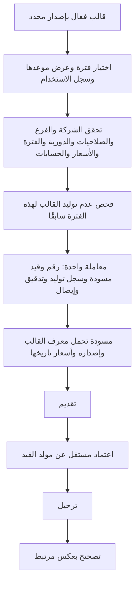

# GL04 — قوالب القيود المتكررة

تنفيذ باك إند مرتبط بشاشة GL04 ومخطط دورة المستند الأصلي. القالب يحفظ اسمًا وفرعًا ودورية ومدة سريان وطريقة توليد وسطـور حسابات ومبالغ ومراكز. التوليد الحالي يُطلب يدويًا ويُنتج **مسودة**؛ تقديمها واعتمادها وترحيلها عمليات مستقلة بصلاحياتها المعتادة.



## العقود والصلاحيات

البادئة `C = /api/v1/companies/{companyId}`. كل كتابة تتطلب `Idempotency-Key`، وكل تعديل أو توليد يتطلب `expectedVersion` للقالب.

| الطريقة | المسار بعد C | الوظيفة والصلاحية |
|---|---|---|
| GET | `/recurring-journals` | بحث بالاسم `search` وفرع `branchId` وحالة `isActive` وصفحات؛ `ledger.read` |
| POST | `/recurring-journals` | إنشاء؛ `journal.recurring.manage` على فرع القالب |
| GET | `/recurring-journals/{id}` | البطاقة والسطور؛ `ledger.read` |
| PUT | `/recurring-journals/{id}` | تعديل الاسم والدورية والسريان والسطور؛ `journal.recurring.manage` |
| POST | `/recurring-journals/{id}/status` | تعطيل أو تفعيل مع سبب؛ `journal.recurring.manage` |
| POST | `/recurring-journals/{id}/generate` | مسودة للفترة؛ `journal.recurring.generate` **و**`journal.write` |
| GET | `/recurring-journals/{id}/schedule?fiscalYearId=...` | مواعيد السنة وحالة الفترة والقيد السابق وحالته؛ `ledger.read` |
| GET | `/recurring-journals/{id}/generations` | سجل الاستخدام المقسم إلى صفحات؛ `ledger.read` |
| GET | `/recurring-journals/{id}/audit-events` | أحداث إنشاء وتعديل وتعطيل البطاقة فقط؛ `ledger.read` و`audit.read` على الفرع |

إدارة إعدادات الشركة وحدها لا تمنح صلاحية إدارة القوالب أو توليد قيود منها. تفويض الصلاحيات يتم بعضوية الشركة المعتادة. عمليات القراءة والتوليد والتحرير وسجل الاستخدام والتغييرات تتحقق من فرع القالب، ولا تكشف قوالب فروع أخرى.

مثال إنشاء، بعد استبدال معرفات الفرع والحسابات بقيم موجودة:

```json
{
  "branchId":"11111111-1111-1111-1111-111111111111",
  "name":"إيجار شهري",
  "frequency":"Monthly",
  "generationMode":"Manual",
  "startsOn":"2026-01-31",
  "endsOn":"2026-12-31",
  "lines":[
    {"accountId":"22222222-2222-2222-2222-222222222222","costCenterId":null,"description":"مصروف الإيجار","currencyCode":"SAR","debit":"1000","credit":"0"},
    {"accountId":"33333333-3333-3333-3333-333333333333","costCenterId":null,"description":"استحقاق الإيجار","currencyCode":"SAR","debit":"0","credit":"1000"}
  ]
}
```

طلب التوليد:

```json
{"expectedVersion":"44444444-4444-4444-4444-444444444444","fiscalPeriodId":"55555555-5555-5555-5555-555555555555"}
```

الإيصال الناتج يعود إلى **القيد الجديد**، ورقم إصداره هو إصدار ذلك القيد. لا يتغير إصدار القالب بمجرد التوليد. للتعديل أو التفعيل استخدم إصدار القالب من قراءة البطاقة؛ ولتقديم القيد استخدم إصدار القيد من إيصال التوليد.

## الدورية والبيانات التاريخية

- الدوريات الحالية `Monthly` و`Quarterly` و`Yearly`، وتُحسب من تاريخ البداية الأصلي. بداية 31 يناير تعطي 28/29 فبراير ثم 31 مارس؛ لا ينتقل مرساة الشهر إلى يوم 28 بسبب فبراير.
- تاريخ الوثيقة والأثر في المسودة المولدة يساوي موعد القالب داخل الفترة. يجب أن يقع داخل السريان وفي فترة مفتوحة. لا توجد موافقة أو كتابة مستقبلية تلقائية من عامل خلفي؛ المستخدم يطلب الفترة صراحة.
- القالب لا يحفظ سعر صرف ثابتًا. عند التوليد، يختار الخادم أحدث سعر نافذ لكل عملة حتى تاريخ الموعد، ثم يثبته في سطور القيد. غياب السعر يمنع التوليد كله.
- يتحقق الحفظ من الحساب والعملة والمركز ودقة المبلغ. يعاد فحصها عند التوليد وعند الاعتماد والترحيل. الحسابات الرقابية محمية من هذه القيود كما في القيد اليدوي.
- يمكن حفظ قالب ينتج قيدًا غير متزن، خصوصًا عند تغير أسعار العملات. يبقى الناتج مسودة قابلة للمراجعة؛ التقديم والاعتماد والترحيل تتطلب اتزانًا دقيقًا. لا يولد النظام فرق صرف أو سطر تقريب مخفيًا.
- تعديل القالب يؤثر على التوليد اللاحق ولا يعدل قيودًا سبق توليدها. تحفظ كل عملية `TemplateVersion`، ويمكن مراجعة إعداد ذلك الإصدار من أحداث تدقيق البطاقة. التقويم يبقي التوليد السابق ظاهرًا حتى بعد تغيير مواعيد السريان.
- يمكن تحرير سطور المسودة المولدة عبر عقد تعديل القيود المعتاد؛ يبقى مصدرها وإصدار قالبها ثابتين، ويسجل التدقيق التعديل.

## منع التكرار ومصدر القيد

يوجد قيد فريد في SQL على `(CompanyId, TemplateId, FiscalPeriodId)` وآخر على `(CompanyId, JournalId)`. إعادة مفتاح الطلب نفسه تعيد الإيصال الأول بعد إعادة فحص صلاحيات المستخدم. مفتاح آخر للفترة المولدة يعيد `recurring_already_generated`، حتى بعد إلغاء المسودة أو تغيير إصدار القالب. الإلغاء لا يمحو سجل التوليد ولا يعيد استخدام الرقم.

القفل المالي نفسه يجمع القيد والسطور والتسلسل وسجل التوليد والتدقيق وإيصال الطلب. فشل أحدها يعيدها جميعًا. لا يُنشأ Outbox للترحيل بمجرد إنشاء المسودة؛ ينشأ عند نجاح الترحيل المعتاد فقط.

حقل مصدر القيد `Source` يأخذ `Manual` أو`Recurring` أو`Reversal`. لا يسمح طلب إنشاء القيد اليدوي بتحديد مصدر آلي. يحتفظ القيد الدوري بـ`RecurringTemplateId` و`SourceTemplateVersion`، وتُمنع إعادة كتابة مصدر قيد محفوظ في طبقة الحفظ. قائمة القيود تدعم `source=Recurring` أو المصدرين الآخرين. هذا يحدد منشأ القيد؛ شاشة كتالوج أنواع المستندات GL14 القابلة للإعداد لم تُنفذ بعد.

## ترقية قاعدة البيانات والتحقق

يجب تطبيق [002_recurring_journals.sql](../../backend/database/002_recurring_journals.sql) بعد الإصدار 001، ثم إعادة تطبيق [runtime-role.sql](../../backend/database/runtime-role.sql). لا تعدّل سكربت 001 السابق. الترقية تضيف ثلاث جداول وحقول مصدر القيد، وتعرّف القيود العكسية القديمة كمصدر Reversal مع الاحتفاظ بمبالغها وتواريخها وإصداراتها.

الإصدار 002 يضيف القوالب؛ يتطلب `/health/ready` في التطبيق الحالي أيضًا الإصدارات 003 إلى 010؛ راجع [بطاقة GL01](accounts.md) و[دليل التهيئة](currencies-and-cost-centers.md)، ثم أعد تطبيق runtime-role.sql. لا تطبق API الترقية تلقائيًا، ويجب تنسيقها مع إصدار التطبيق. سجل التوليد محمي من التعديل والحذف في التطبيق ودور قاعدة البيانات؛ تعطيل القالب هو أسلوب إيقافه دون حذف تاريخه.

اختبارات [RecurringTests.cs](../../backend/tests/Ameen.Erp.Tests/RecurringTests.cs) تشمل التقويم والفروع والصلاحيات والأسعار والإصدارات والتراجع ودورة القيد. وتختبر [RecurringSqlIntegration.cs](../../backend/tests/Ameen.Erp.Tests/RecurringSqlIntegration.cs) اتصالات مستقلة ومفاتيح متنافسة وفشل حفظ حقيقي وصلاحيات التشغيل. ويختبر [SchemaUpgradeIntegration.cs](../../backend/tests/Ameen.Erp.Tests/SchemaUpgradeIntegration.cs) فشل ترقية DDL والتراجع ثم حفظ البيانات القديمة بعد نجاحها. اختبارات المضيف تستخدم HTTPS وJWT حقيقيًا ضد جهة OIDC مؤقتة.

عند استخدام [فترات SYS03 المخصصة](fiscal-calendar.md)، يرفض التقويم الدوري والتوليد فترة تحتوي أكثر من موعد للقالب برمز `ambiguous_recurring_period`، لأن التوليد الحالي واحد لكل قالب وفترة.
