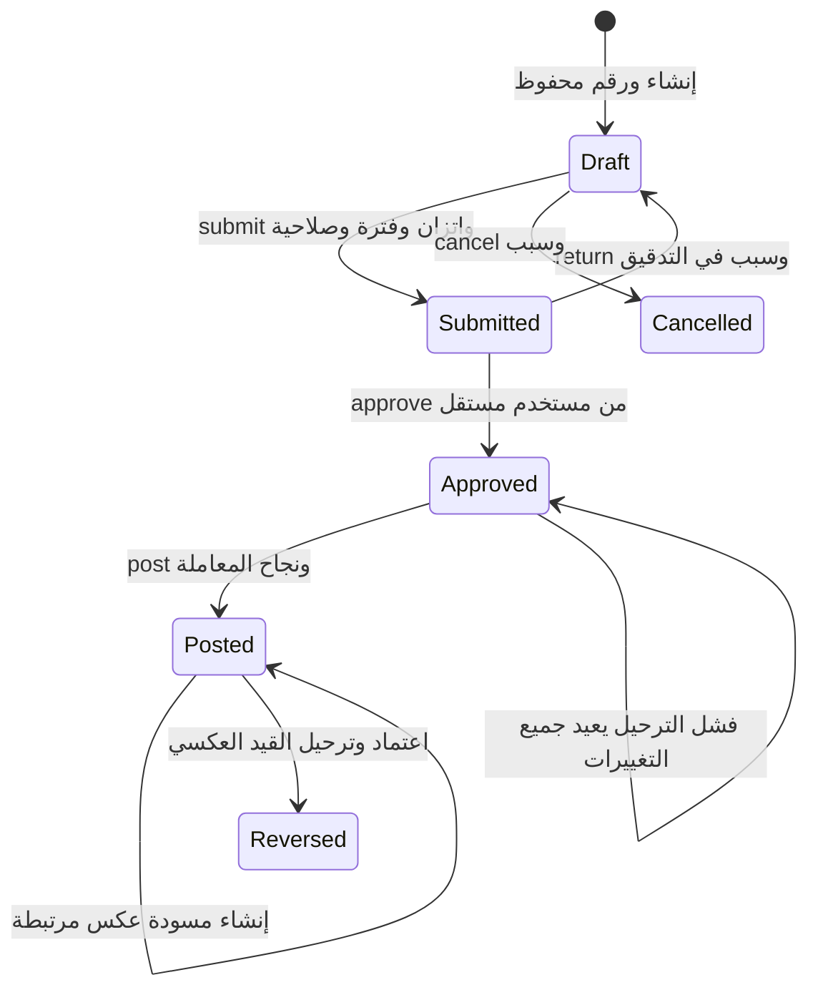

# المطابقة مع التحليل والمخططات

المرجع هو مجلد `muhaseb-erp-analysis` الأصلي، وقد بقيت ملفاته دون تغيير. التنفيذ الحالي أساس للأستاذ العام والتهيئة، **وليس اكتمالًا للشاشات الـ150**. توجد أجزاء منفذة في 22 شاشة ووظيفة، ولا توجد شاشة معلن اكتمال جميع حقولها وخياراتها بعد. المطابقة مع إصدار محدد من منتج المتكامل نفسه ما زالت غير موثّقة كما ورد في [سجل المطابقة الأصلي](../../muhaseb-erp-analysis/docs/06-reference-parity.md).

أُنشئت أربعة سجلات منفصلة حتى لا يختلط وجود endpoint باكتمال شاشة:

| السجل | التغطية |
|---|---|
| [الشاشات](screens-implementation.csv) | 150 صفًا: الجزء المنفذ وواجهاته وما بقي لكل شاشة |
| [الحقول](fields-implementation.csv) | 2759 حقلًا: العقد المقابل أو الحالة pending |
| [المخططات](diagrams-implementation.csv) | المخططات الـ28 وحدود التنفيذ داخل كل واحد |
| [قواعد العمل](rules-implementation.csv) | BR01–BR20 مع نطاق الاختبار والوظائف المتبقية |

الملف [implementation-map.json](implementation-map.json) قابل للقراءة البرمجية. الحالات `implemented` في سجل الحقول تعني وجود الحقل المحدد في العقد المنفّذ، و`derived` يعني اشتقاقه من مرجع، و`audit` يعني وجوده في أحداث التدقيق دون حقل مباشر في نموذج الشاشة، و`partial` يعني فرق نطاق موثّق. هذه ليست حالات نجاح اختبار واجهة أو شهادة اكتمال وظيفة الإنتاج.

## تطابق دورة القيد



يقابل ذلك [document-lifecycle.mmd](../../muhaseb-erp-analysis/diagrams/source/document-lifecycle.mmd). التحقق والرفض ومحاولة الترحيل مراحل في العملية أو أحداث تدقيق؛ ليست حالات مالية دائمة منفصلة. الإعادة من Submitted فقط، والإلغاء من Draft فقط. القيد المعتمد لا يعدّل. الأصل يبقى مؤثرًا ماليًا بعد عكسه، ويعادله قيد العكس بتاريخ أثره.

## حدود يجب الحفاظ عليها عند التوسعة

| مرجع التحليل | المنفذ الآن | العمل المتبقي |
|---|---|---|
| data-model | Company/Branch/Account/Period/Journal/Line/Audit/Outbox | DOCUMENT، الأطراف، الربط السطري، المخزون والذمم والضرائب |
| posting-sequence وBR05 | قيد يدوي + Audit + Outbox + إيصال في معاملة واحدة | دفاتر مساعدة وعامل تسليم قابل للإعادة |
| period-close وBR14 | إقفال فترة الأستاذ بعد معالجة المعلق | مطابقة بنوك وذمم ومخزون وأصول وضريبة وإقفال نتائج السنة |
| GL03 متعدد العملات | مبلغ وعملة وسعر لكل سطر؛ اتزان وظيفي | المشروع والطرف والعكس المجدول والمرفقات |
| GL04 | قوالب شهرية وربع سنوية وسنوية؛ توليد يدوي لمسودة واحدة لكل فترة؛ تقويم واستخدام وتدقيق بإصدار | طرق توليد مجدولة وخيارات دورية إضافية إذا اعتمدت؛ التوليد الحالي Manual فقط |
| SYS07/SYS08 وBR18 | صلاحيات عمليات وعضويات وفروع | أدوار قابلة للإدارة وحدود مبلغ ونطاق حساب ومخزن وصندوق وسعر وتصدير |
| RPT01/RPT02 | ميزان بمستويات الدليل ومركز وإخفاء الصفري؛ أستاذ حساب بمركز ومرجع خارجي | نطاق حسابات وطرق عرض عملات وتصدير وطباعة ومعالجة أحجام كبيرة |
| SYS09 | فصل المنشئ والمعتمد إلزامي | مسارات مرنة ومتعددة المراحل |
| SYS10 | JV لكل شركة وسنة | إعداد أنواع وتسلسلات وبوادئ وفروع |

لا يُسمّى endpoint إقفال الفترة الحالي إقفال ERP شاملًا. عند إضافة أي دفتر مساعد يجب توسيع فحوص الإقفال قبل تمكينه؛ لا يصح تشغيل وحدة مخزون أو ذمم ثم الاحتفاظ بفحص الأستاذ وحده.

أنشأ العميل UUID الشركة لتثبيت نطاق أول طلب قابل لإعادة المحاولة؛ ترقيم المستندات المالية من الخادم دائمًا. أسعار الصرف الحالية واحدة للعملة والتاريخ، وليست أنواع شراء وبيع متعددة. مراكز التكلفة والحسابات تدعم أبًا وأبناء؛ تقارير المراكز الحالية ما زالت تصفي المركز نفسه دون جمع شجرته. هذه حدود تنفيذ مسجلة وليست حذفًا لمتطلبات التحليل.

## إبقاء السجل محدثًا

مصدر الخريطة [traceability.py](../../backend/scripts/traceability.py). عدّل الربط الصريح عند تنفيذ حقل أو وظيفة، ثم ولّد الملفات وافحصها:

```bash
python3 backend/scripts/traceability.py
python3 backend/scripts/traceability.py --check
```

يفحص السكربت بصمات ملفات التحليل الأصلية، ومراجع الحقول، وعدد الشاشات والحقول والمخططات، وتطابق الملفات المولّدة. لا يستنتج اكتمال الشاشة تلقائيًا ولا يغني عن مراجعة العقود والسلوك. إدراج سطر في المصفوفة لا يثبت وحده نجاح سلوك الأعمال.

## ترتيب الاستكمال

1. استكمال فجوات التهيئة والأستاذ وحقولهما وإعداد جهة هوية النشر؛ ثبت التشغيل محليًا على .NET 10 وSQL Server وجهة OIDC اختبارية.
2. الأطراف وحساباتها والأرصدة الافتتاحية التفصيلية، ثم الصناديق والبنوك وسندات القبض والصرف والتخصيص.
3. المخزون والمشتريات والمبيعات وربط الكميات والمستندات وإجراءات المرتجع مع BR11–BR16 وBR19.
4. ملفات الدولة والضريبة والتكامل الإلكتروني بعد التحقق من مرجع تشريعي مؤرخ؛ لا نسب إنتاج افتراضية.
5. الأصول والتكاليف والموارد البشرية والتقارير الشاملة، ثم الأقسام التخصصية حسب نطاق التحليل.

مرجع كل خطوة هو المخطط الأصلي واختبارات القبول المقابلة، مع الحفاظ على معاملة مالية واحدة والتصحيح بمستند مرتبط.

## دفعة GL01

نُفذت الحقول GL01-F05 وF07 وF11، وتعديل البطاقة وسجلا الاستخدام والتغييرات، مع منع دورات الشجرة وتغيير بنية الحساب المستخدم أو أحد أسلافه. تُقفل البنية عند وجود مرجع في أي حالة قيد أو قالب حالي حتى المعطل؛ الأسماء والملاحظات قابلة للتعديل مع تدقيق. هذه سياسة تحفظية لتنفيذ قاعدة منع تغيير تصنيف المستخدم دون تحويل معتمد. مسار التحويل نفسه لم يُنفذ. يوضح [عقد GL01](accounts.md) قواعد كل حقل.

أضيف GL01-F17 كعدد صحيح `Revision` يبدأ من 1 ويزداد عند حفظ التعديل أو الحالة؛ بقي `Version` رمز تزامن تقنيًا مستقلًا. بقيت ملفات التحليل الأصلية دون تعديل، ولم تُعلن الشاشة مكتملة لمجرد وجود جميع أسماء الحقول.

## دفعة SYS04 وCOST01

أضيفت بطاقة العملة بأسمائها ورمز العرض واسم الجزء وحالتها وتعديلها والبحث والتدقيق، مع منع تغير الدقة بعد الاستخدام وإعادة فحص الحالة عند الترحيل. أضيفت شجرة المراكز ومسؤول المركز والأسماء والملاحظات والتعديل والتعطيل وسجلا الاستخدام والتغييرات. تستخدم البطاقتان Revision عددًا صحيحًا مستقلًا عن Version التقني.

يبقى نوع المركز COST01-F11 غير منفذ لحين تحديد قيمه، والرمز الداخلي للعملة موحد مع رمزها ذي الثلاثة أحرف دون تحقق من قائمة ISO خارجية. لا يوجد ادعاء باكتمال وحدة التكاليف أو الباك إند كله. راجع [العقود والقيود](currencies-and-cost-centers.md).

خطة الاعتماديات لجميع مراحل الباك إند موثقة في [خطة الاستكمال](completion-plan.md)؛ الحالة المنفذة تظل هي المصفوفات والدليل الاختباري، لا بنود الخطة.

## امتداد SYS01

أضيفت حقول الملف القانوني والعنوان وحالة الشركة وإصدارها العددي، وتعديل البطاقة وسجلها وملخص الاستخدام. يمنع التعطيل الكتابة وإعادة أوامر سابقة، مع إبقاء القراءة المصرح بها وتعديل البطاقة وإعادة التفعيل. بداية أول سنة ترتبط بالبطاقة وتغيير العملة محجوب بعد وجود قيود أو أسعار أو قوالب. بقيت الشاشة جزئية لأن مرجع الدول والسياسات الشرطية الخاصة بالاختصاص غير منفذة؛ الحقول القانونية لا تعني تحققًا قانونيًا. تفاصيل العقد والترقية في [companies.md](companies.md).

## امتداد SYS02

نفذت حقول العنوان والشجرة والمركز الافتراضي والإصدار العددي، والبحث والتعديل والتعطيل والاستخدام وسجل البطاقة، مع حماية نطاق الفروع وقفل بنية المستخدم. بقي المدير ونوع الموقع غير منفذين لعدم تحديد مرجعهما وقيمهما في التحليل. المصفوفة لا تصنف الشاشة مكتملة؛ تفاصيل العقد في [branches.md](branches.md).

## امتداد SYS03

أصبح إنشاء السنة يدعم سطور فترات صريحة تغطيها بالكامل دون تداخل أو فجوات، مع بقاء التوليد الشهري الافتراضي. أضيف عرض التقويم والبحث والاستخدام وسجل إقفال وفتح الفترات. حالة السنة مشتقة من إقفال الأستاذ فقط. أزيل ربط F13 بـVersion لأن GUID لا يحقق نوع العدد الصحيح المطلوب؛ بقي الإصدار العددي والتعديل والتقويم الفرعي والإقفال الشامل فجوات معلنة. تفاصيل العقد في [fiscal-calendar.md](fiscal-calendar.md).

## امتداد SYS05 وGL11

أضيف البحث التاريخي في أسعار الصرف والسعر النافذ المحدد الاتجاه، وبطاقة السعر واستخدامه وتدقيقه، ومعاينة إقفال فترة الأستاذ بشروط مفصلة وقيود مانعة بصفحات. لم تنفذ أنواع السعر وتعطيله أو مطابقة بقية الدفاتر وقيد إقفال السنة. صححت ربط الإصدار في SYS05 وGL11: Version التقني ليس العدد الصحيح المطلوب. تفاصيل [العقد والحدود](rates-and-close-preview.md).
