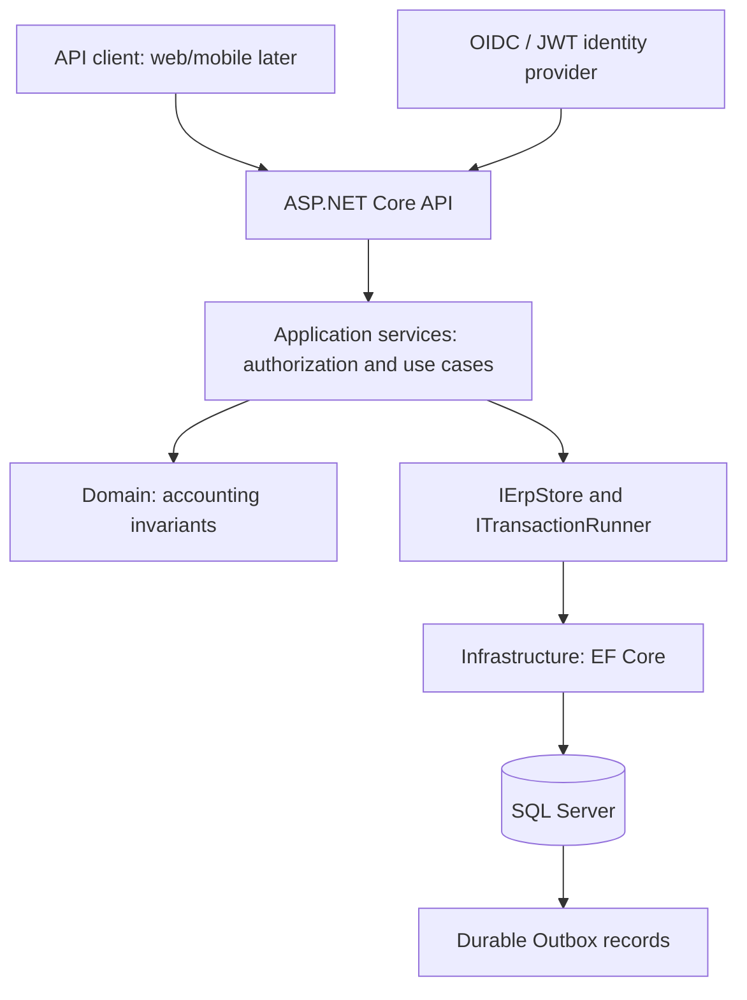

# Architecture at a glance | نظرة معمارية

This summary is for onboarding. The technical source is [docs/backend/architecture.md](../backend/architecture.md), and changes to behavior must be checked against source code.

## Request path

The backend is a **modular monolith**. Future Flutter web/mobile clients are proposed, not delivered. The Outbox exists for durable events, but general delivery/notification of those events is not guaranteed implemented.

## Code organization

- `backend/src/Ameen.Erp.Domain` — accounting/domain entities and invariants.
- `backend/src/Ameen.Erp.Application` — contracts, services, checks and orchestration.
- `backend/src/Ameen.Erp.Infrastructure` — database configuration and persistence.
- `backend/src/Ameen.Erp.Api` — endpoints, authentication and OpenAPI contract.
- `backend/tests/Ameen.Erp.Tests` — executable tests.
- `backend/database` — ordered SQL schema migrations.

## Non-negotiable invariants

1. **Tenant isolation:** never access a different company's records by accepting a supplied ID alone.
2. **Authorization:** action and branch scope are verified in application logic, not inferred from headers.
3. **Atomic financial updates:** postings, audit, numbering, Outbox and command receipts remain consistent on failure/retry.
4. **Precision:** use `decimal` and defined currency precision, not binary floating point for money.
5. **Concurrency/idempotency:** preserve command identities, revision checks, and safe transaction boundaries.
6. **Bounded claims:** a partial screen or scaffolding is not a complete ERP function.

## Where to understand one feature

Start with the feature's analysis in `muhaseb-erp-analysis/docs`, follow [traceability](../backend/traceability.md), find its contract in `docs/backend`, then read the endpoint/service/domain/EF/tests. Check the latest [progress log](../backend/PROGRESS.md) before changing anything.
